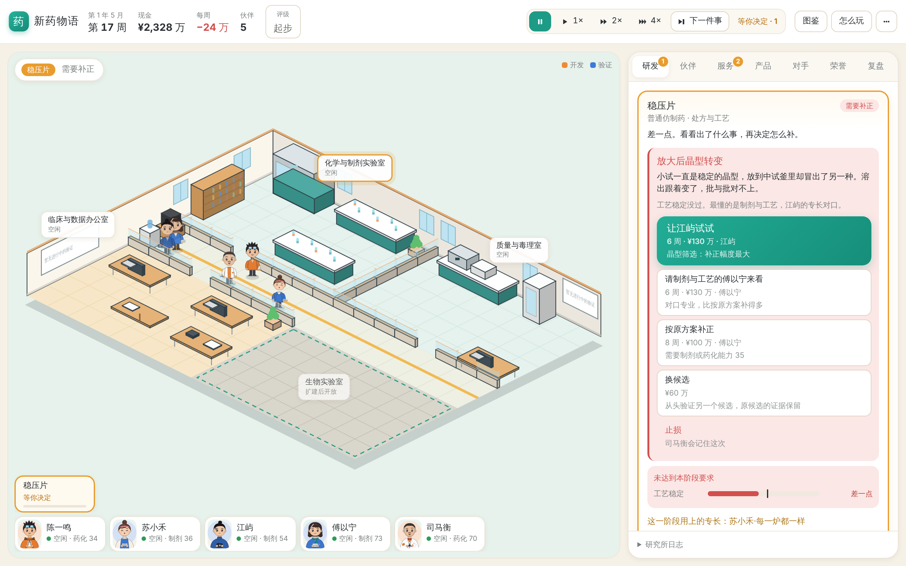

# 新药物语 · 一屏研究所 v0.13

从街角实验室起步的制药经营游戏。点选房间和伙伴，安排仿制、改良或创新研发；用服务与授权维持现金流，培养伙伴，在十年或二十年任期结束时拿到研究所评级。

**v0.13 让中期有目标，角色有戏。**
- 每年研究大会后，从三个年度目标里选一个当作明年的事。
- 新的第 3 章「新的实验室」，一共六章。
- 专长起作用时人物头顶飘字；每位伙伴有一个带冷却的主动技能。
- KRAS G12C、乙肝、Lp(a) 和阿尔茨海默一样有搭档关：请到对的人才好做。
- 没过线时有一张失败事件卡：出了什么事、谁最懂、可以请谁来补。
- 钱多了有地方花：自有产线、患者援助、青年学者计划、临床病房。



[当前玩法](design/game-design.md) · [内容与角色](design/content.md) · [技术接口](design/tech.md) · [本版试玩记录](design/v13-playtest.md) · [实施方案](design/v12-plan.md) · [v0.12 记录](design/v12-playtest.md) · [v0.11 评估](design/review-v11.md) · [GitHub Releases](https://github.com/LucasYL/drugstory/releases)

**v0.13.1 升级保护：** 从 v8 旧存档迁移时，缺少入职记录的伙伴从升级当周开始计算退休年限，给玩家完整的传承准备时间。已有入职记录保留。独立复核与后续建议见 [review-v13-codex.md](design/review-v13-codex.md)。

## 开始游玩

需要 Python 3.12+ 与 uv：

```bash
git clone https://github.com/LucasYL/drugstory.git
cd drugstory
uv sync --dev
./scripts/run-career.sh
```

打开 **http://127.0.0.1:8885/scene**。文字界面在 **http://127.0.0.1:8885/**。

1. 左上角的引导条告诉你现在该做什么。有决定时指向决定；没有时给出跟着章节走的下一步（晋阶、扩建、邀请、个人课题、开新项目），点一下就做。
2. 点 ▶ 1× / 2× / 4× 让时间走，有决定或第一次出现成长机会时自动停；「下一件事」直接跳到下一件需要你的事。
3. 右侧决定卡的大按钮就是推荐方案，回车也能执行。证据写成一个词，悬停看数字；「⋯」里可以打开「显示数字」。
4. 第二款仿制药起，新项目卡上写着每周利润和对手，选「标准 / 加急 / 精工」后点「交给团队」，团队会一路做到上市，遇到补正才停下来问你。
5. 创新药：新项目选「创新药」，先挑一种病，再从主流路线里选；想自由组合点「自己设计组合」。
6. 顶栏评级点开能看五项分数、离下一档差几分，以及最近的三条涨分办法。前两年显示「起步」。
7. 每年研究大会后选一个年度目标；伙伴晋升精英后，人物卡和决定卡上会出现他的主动技能。
8. 阶段没过时看事件卡：请对口的人来补，比按原方案补得多。现金多了，在产品卡上建自有产线、开患者援助，在研究所里办青年学者计划、建临床病房。

快捷键：空格 暂停/继续，1、2、3 切换速度，N 下一件事，回车 执行推荐方案。每次成功操作都自动存盘。

```bash
uv run drugstory-web --port 8885 --seed 42                                      # 新局默认十年任期
uv run drugstory-web --term 20 --port 8897 --save-path saves/long.json          # 二十年
uv run drugstory --scenario foundation --seed 42
```

**存档：v0.13 写 v11 格式，旧版本的文件只读不改。**
- 网页默认存档是 `saves/scene-autosave.json`。启动时按「`-v13` → `-v12` → `-v11` → 原文件」的顺序找第一个存在的存档：已经是 v11 就写回它自己，否则读它、新进度写到 `<原名>-v13.json`。v0.12、v0.11、v0.10 的进度都会被接着玩，原文件一个字节都不改。
- 读入旧存档时，已经走到原第 3 章及以后的，章节顺延一位，新插入的「新的实验室」算作跳过、不补奖励。
- v0.12 读不了 v11；要回到 v0.12，用 v0.12 的代码按原来的命令启动，读到的是升级前的进度（`-v12`）。
- 不要让两个服务同时写同一个文件。服务只监听本机。
- 游玩记录（可选）：`--playlog saves/playlog.jsonl`，线上用 `--playlog-dir DIR` 每个账号一份。只写在本机，不进存档；`uv run python scripts/playlog-report.py saves/playlog.jsonl` 汇总。

## 跨设备试玩

v0.10.1 支持挂在 HTTPS 子路径上。试玩入口为 [researchbuddy.cc/game/](https://researchbuddy.cc/game/)，从电脑和手机使用同一游戏账号登录时，共用服务端存档。v0.10.2 支持多个账号，各有独立进度。多个设备同时操作会触发版本冲突提示，重新读取进度后再决定。

自行部署时，先在仓库外准备权限为 600 的登录文件，每行写一个 `用户名:密码`。首行账号使用 `--save-path` 指定的原存档，其余账号用旁边的 `<存档名>-accounts` 目录。切换账号时可以打开新的无痕窗口。用反向代理终止 TLS，保留外部 Host 和原始路径，转发至本机端口：

```bash
uv run drugstory-web --port 8902 --public-url https://example.com/game/ \
  --auth-file /path/to/private/login.txt --save-path saves/hosted-autosave.json
```

线上模式的子路径首页显示场景，`/game/text` 是文字版。游戏资源和 API 都在同一前缀下，游戏服务绑定回环地址。通过独立保存路径保留跨设备进度。

**线上服务升级到 v0.13：** `git pull`、`uv sync` 后用原来的命令重启，参数不变。每个账号按上面的规则接着最新的进度玩（v8 原档、`-v11`、`-v12` 都不改），新进度写到 `<原名>-v13.json`，其他账号在 `<存档名>-accounts/<用户名>-v13.json`。要收集真人游玩数据，加 `--playlog-dir saves/playlog`。

## 本版变化

- **年度目标**：每年三选一，14 种。完成发奖金和声誉，并计入评级；不选、没完成都不罚。
- **新章节**：「新的实验室」插在第 2、3 章之间，共六章。
- **专长看得见**：起作用时人物头顶飘字、日志记一笔，按钮和阶段结果写出用上了谁。
- **主动技能**：每位伙伴一个，晋升精英后解锁，冷却 96 周（传奇 144 周）。
- **难病搭档关**：KRAS G12C、乙肝、Lp(a) 各三道，阿尔茨海默四道。疾病卡写出缺了谁、研究所里谁能过。
- **失败事件卡**：写出原因和谁最懂。让对口专长的角色试试（+12）、请对口专业的人来看（+9），比按原方案补正（+6）补得多。
- **花钱的出口**：
  - 自有产线：毛利更高，不受供货折减；
  - 患者援助：花销售额的 12%，让更多患者用上；
  - 青年学者计划：团队传承；
  - 临床病房：多一个自营临床席位。
  
  高铁峰的专长改为只作用于自有产线。
- **引导修正**：个人课题只在有对口的空闲伙伴时才提，不再挡住后面的建议。
- **存档 v11**：年度目标、学者计划、病房字段；读入旧存档时章节顺延一位。

## 验证与复现

```bash
uv run pytest -q
uv run ruff check .
uv run ruff format --check .
node --test tests/test_scene_transport.cjs
uv run python scripts/generate-api-types.py --check
uv run python scripts/playtest-v13.py --seeds 12 --jobs 4
uv run python scripts/playtest-v13.py --players evidence --seeds 24 --jobs 4 --output .artifacts/v13-evidence24
uv run python scripts/boundary-challenges.py --seeds 40
node scripts/ui-autoplay.cjs --port 8931 --weeks 480 --guide   # 先在 8931 启动一个独立新局
```

验证范围：
- 245 项 Python 测试和 9 项 Node 测试；全部 JS 语法检查；Schema 与类型同步。
- 浏览器：
  - 只点界面的新手 5 个种子十年；
  - 失败事件卡（桌面和手机）、产线和病房按钮；
  - v0.12 存档读入；v0.12 同时运行。

模拟结果：
- 证据型玩家 48 局 20 年：期末现金中位数从 4.26 亿降到 2.55 亿（目标 2.5 亿），总分中位数 70.9 → 74.4，停业 1 → 0。
- 四种自动玩家 120 局：总分普遍涨 2–6 分（年度目标和学者计划），新手 · 创新研究社有 2 局停业（不选年度目标的对照 0 局）。
- 难病搭档关边界：凑齐对的人获批 82–92%，部分 38–42%，没人 5–12%。
- v0.8 策略 28 局无停业。
- 所有模拟只用独立新局，输出在被忽略的 `.artifacts/`。自动策略的结果不是人类玩家的胜率。详见 [v13-playtest.md](design/v13-playtest.md)。

## 历史版本

每版保留不可移动 tag 和 Release。需要旧版时另建目录，按对应 README 指定独立端口和存档，不会自动关闭现有服务：

```bash
git worktree add --detach ../drugstory-v12 v0.12.0
cd ../drugstory-v12
uv sync --dev
uv run drugstory-web --port 8886 --save-path saves/scene-autosave.json
```

v0.12、v0.11、v0.10 默认也用 8885；和 v0.13 同时运行时，像上面这样给旧版换一个端口，各用各的存档。v0.8 使用 8884，v0.7 使用 8883，v0.6 使用 8881，v0.5 使用 8880。旧 MVP 引擎与测试可在 v0.3.0 查阅。
