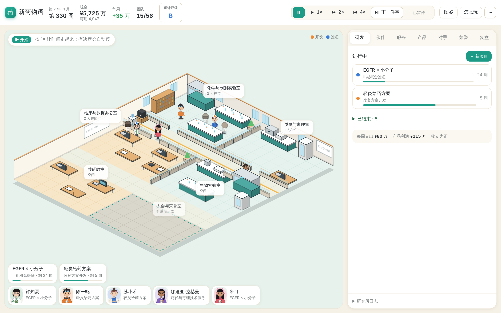
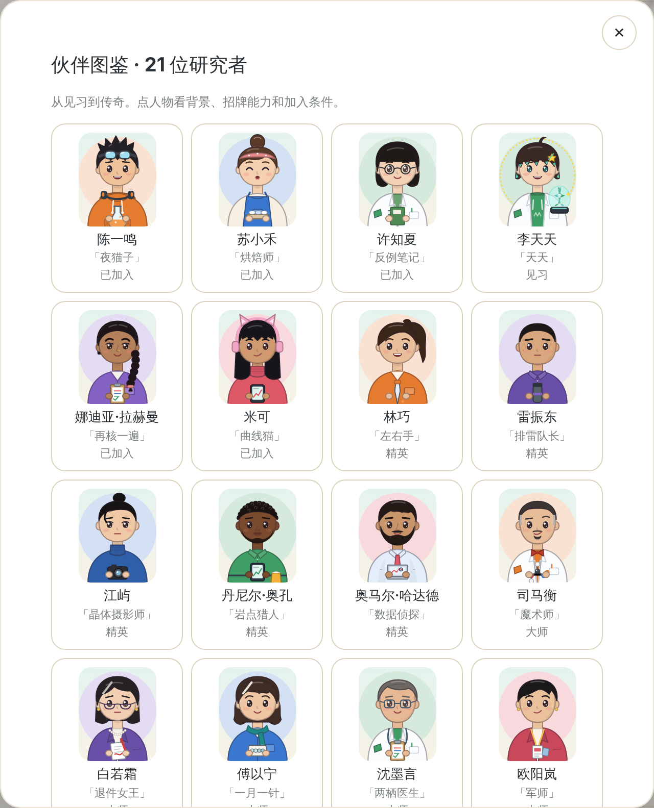

# 新药物语 · 一屏研究所 v0.11

从街角实验室起步的制药经营游戏。点选房间和伙伴，安排仿制、改良或创新研发；用服务与授权维持现金流，培养伙伴，在十年或二十年任期结束时拿到研究所评级。

**v0.11 让一局有终点，让每个人不可替代。**
- 任期结束按五项打分评 S 到 D，并给出结局。
- 五个章节目标、疾病地图和患者委托，给每一两年一个看得见的目标。
- 年度评选自动参评。
- 21 位伙伴各有一项改变规则的专长；传奇会退休、会传承。
- 阿尔茨海默病是「最后的难题」：凑齐对的人才有机会。
- 人物换上新画风。



[当前玩法](design/game-design.md) · [内容与角色](design/content.md) · [技术接口](design/tech.md) · [本版试玩记录](design/v11-playtest.md) · [本版方案](design/v11-proposal.md) · [本版评估与建议](design/review-v11.md) · [v0.10 记录](design/v10-playtest.md) · [GitHub Releases](https://github.com/LucasYL/drugstory/releases)

## 开始游玩

需要 Python 3.12+ 与 uv：

```bash
git clone https://github.com/LucasYL/drugstory.git
cd drugstory
uv sync --dev
./scripts/run-career.sh
```

打开 **http://127.0.0.1:8885/scene**。文字界面在 **http://127.0.0.1:8885/**。

1. 左上角目标条告诉你现在该做什么；没有急事时显示当前章节目标，点开看章节、疾病地图和患者委托。
2. 点 ▶ 1× / 2× / 4× 让时间走，有决定会自动停；「下一件事」直接跳到下一件需要你的事。
3. 右侧决定卡的大按钮就是推荐方案，先写成功机会高、中、低。橙色「研究顾问」框出现时值得看一眼：比如创新药进临床前获益不够宽裕，它会建议先做定向优化。
4. 顶栏的「预计评级」点开能看五项分数：惠及患者、科学突破、团队传承、经营稳健、行业声誉。
5. 伙伴页能看到每个人的专长、潜力上限和觉醒条件；传奇的卡上有退休倒计时和「传承」按钮。
6. 想挑战阿尔茨海默病：新项目选「β-淀粉样蛋白」，卡片上列出四道关和谁能过。

快捷键：空格 暂停/继续，1、2、3 切换速度，N 下一件事。每次成功操作都自动存盘。

```bash
uv run drugstory-web --port 8885 --seed 42 --save-path saves/scene-autosave-v11.json
uv run drugstory-web --term 10 --port 8897 --save-path saves/short-v11.json   # 十年短局
uv run drugstory-web --load saves/scene-autosave.json --port 8898              # 接着玩 v0.10 的存档
uv run drugstory --scenario foundation --seed 42
```

**存档：v0.11 写 v9 格式。**
- 可以读 v0.10 的 v8 存档，但不会改写原文件：新进度另存到 `<原名>-v11.json`。v0.10 读不了 v9。
- 网页默认存档改为 `saves/scene-autosave-v11.json`，和 v0.10 的 `saves/scene-autosave.json` 互不干扰。
- 不要让两个服务同时写同一个文件。服务只监听本机。

## 跨设备试玩

v0.10.1 支持挂在 HTTPS 子路径上。试玩入口为 [researchbuddy.cc/game/](https://researchbuddy.cc/game/)，从电脑和手机使用同一游戏账号登录时，共用服务端存档。v0.10.2 支持多个账号，各有独立进度。多个设备同时操作会触发版本冲突提示，重新读取进度后再决定。

自行部署时，先在仓库外准备权限为 600 的登录文件，每行写一个 `用户名:密码`。首行账号使用 `--save-path` 指定的原存档，其余账号用旁边的 `<存档名>-accounts` 目录。切换账号时可以打开新的无痕窗口。用反向代理终止 TLS，保留外部 Host 和原始路径，转发至本机端口：

```bash
uv run drugstory-web --port 8902 --public-url https://example.com/game/ \
  --auth-file /path/to/private/login.txt --save-path saves/hosted-autosave.json
```

线上模式的子路径首页显示场景，`/game/text` 是文字版。游戏资源和 API 都在同一前缀下，游戏服务绑定回环地址。通过独立保存路径保留跨设备进度。

**线上服务从 v0.10 升到 v0.11：** 启动命令不变，`--save-path` 仍指向原来的 v8 存档。每个账号的 v8 原档都不改写，新进度写到旁边的 `<原名>-v11.json`（其他账号在 `<存档名>-accounts/<用户名>-v11.json`）；服务重启后接着 `-v11` 那份继续。要退回 v0.10，换回旧代码用同一条命令启动即可，读到的是升级前的 v8 进度。

## 本版变化

- **任期与评级**：开局选十年或二十年；任期结束那周弹出结算，评级和结局定格，之后可以继续经营。
- **章节与地图**：五章目标，每章一到三星和奖励；疾病地图分四层，攻克后亮起，附一句患者的话；约每两年一封患者组织来信。
- **年度评选**：不用报名，每年最多一个大奖，其余记提名；新增研发进展奖，没有新药的年份也能争；越往后越难拿。
- **研究顾问**：在关键时刻提示真正有用的打法，带一键按钮。只看公开证据。
- **角色**：每人一项改变规则的专长，大师后觉醒。
  - 潜力上限：见习 88、精英 91、大师 94、传奇 97，李天天 99。
  - 传奇约八年后退休，可传承专长。
  - 李天天第二年起可邀请。
  - 唐小柚改名娜迪亚·拉赫曼。另有四位换成丹尼尔·奥孔、奥马尔·哈达德、伊莲娜·沃尔科娃、伊莎贝尔·罗哈斯，原有位置、外号和专长不变。
- **最后的难题**：阿尔茨海默病有入脑、选对人、脑水肿、长终点四道关。在构造状态的测试里：
  - 缺了做递送的人，单抗几乎做不出；
  - 只靠大师、按顾问的打法约六成；
  - 四道关齐全约七成半。
- **新画风**：专业色就是衣服颜色，每人一个大剪影；传奇是学术专家；人物长相更多样。



## 验证与复现

```bash
uv run pytest -q
uv run ruff check .
uv run ruff format --check .
node --test tests/test_scene_transport.cjs
uv run python scripts/generate-api-types.py
uv run python scripts/playtest-v11.py --seeds 12 --jobs 4
uv run python scripts/boundary-hard-targets.py --seeds 40
```

验证范围：
- 145 项 Python 测试和 9 项 Node 测试；全部 JS 语法检查；Schema 与类型同步。
- 关键鼠标流程：自动参评、研究顾问、评级与任期结算、四道关、章节、新画法、文字版、手机宽度。

模拟结果：
- 三种自动玩家各跑 20 年，共 96 局：新手多为 C，只点推荐按钮多为 B，按证据打法多为 A；停业 2 局，原因见试玩记录。
- 所有模拟只用独立新局，输出在被忽略的 `.artifacts/`。自动策略的结果不是人类玩家的胜率。

## 历史版本

每版保留不可移动 tag 和 Release。需要旧版时另建目录，按对应 README 指定独立端口和存档，不会自动关闭现有服务：

```bash
git worktree add --detach ../drugstory-v10 v0.10.0
cd ../drugstory-v10
uv sync --dev
uv run drugstory-web --port 8886 --save-path saves/scene-autosave.json
```

v0.10 和 v0.9 默认也用 8885；和 v0.11 同时运行时，像上面这样给旧版换一个端口，各用各的存档。v0.8 使用 8884，v0.7 使用 8883，v0.6 使用 8881，v0.5 使用 8880。旧 MVP 引擎与测试可在 v0.3.0 查阅。
