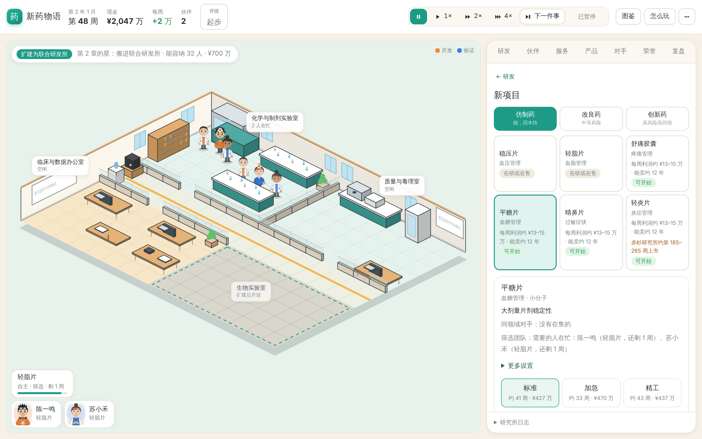

# 新药物语 · 一屏研究所 v0.12

从街角实验室起步的制药经营游戏。点选房间和伙伴，安排仿制、改良或创新研发；用服务与授权维持现金流，培养伙伴，在十年或二十年任期结束时拿到研究所评级。

**v0.12 让新玩家前一小时走得通，每一步都有选择。**
- 左上角引导跟着章节走：该晋阶、该扩建、该邀请谁，按钮点一下就做；第一次出现的成长机会会停下来提醒。
- 第二款仿制药起可以交给团队做完：选市场、选标准 / 加急 / 精工，之后自动上市。
- 证据和结果先说一个词（很可能过、差一点……），数字放进悬停提示。
- 创新药先选病，再从两到四条主流路线里选。
- 手机上，等你决定的卡片压在场景底部。



[当前玩法](design/game-design.md) · [内容与角色](design/content.md) · [技术接口](design/tech.md) · [本版试玩记录](design/v12-playtest.md) · [实施方案](design/v12-plan.md) · [v0.11 评估](design/review-v11.md) · [v0.11 记录](design/v11-playtest.md) · [GitHub Releases](https://github.com/LucasYL/drugstory/releases)

## 开始游玩

需要 Python 3.12+ 与 uv：

```bash
git clone https://github.com/LucasYL/drugstory.git
cd drugstory
uv sync --dev
./scripts/run-career.sh
```

打开 **http://127.0.0.1:8885/scene**。文字界面在 **http://127.0.0.1:8885/**。

1. 左上角的引导条告诉你现在该做什么。有决定时指向决定；没有时给出跟着章节走的下一步（晋阶、扩建、邀请、个人课题、开新项目），点一下就做。
2. 点 ▶ 1× / 2× / 4× 让时间走，有决定或第一次出现成长机会时自动停；「下一件事」直接跳到下一件需要你的事。
3. 右侧决定卡的大按钮就是推荐方案，回车也能执行。证据写成一个词，悬停看数字；「⋯」里可以打开「显示数字」。
4. 第二款仿制药起，新项目卡上写着每周利润和对手，选「标准 / 加急 / 精工」后点「交给团队」，团队会一路做到上市，遇到补正才停下来问你。
5. 创新药：新项目选「创新药」，先挑一种病，再从主流路线里选；想自由组合点「自己设计组合」。
6. 顶栏评级点开能看五项分数、离下一档差几分，以及最近的三条涨分办法。前两年显示「起步」。

快捷键：空格 暂停/继续，1、2、3 切换速度，N 下一件事，回车 执行推荐方案。每次成功操作都自动存盘。

```bash
uv run drugstory-web --port 8885 --seed 42                                      # 新局默认十年任期
uv run drugstory-web --term 20 --port 8897 --save-path saves/long.json          # 二十年
uv run drugstory --scenario foundation --seed 42
```

**存档：v0.12 写 v10 格式，旧版本的文件只读不改。**
- 网页默认存档是 `saves/scene-autosave.json`。启动时按「`-v12` → `-v11` → 原文件」的顺序找第一个存在的存档：已经是 v10 就写回它自己，否则读它、新进度写到 `<原名>-v12.json`。所以 v0.11 的进度（`-v11.json`）和 v0.10 的进度（原文件）都会被接着玩，原文件一个字节都不改。
- v0.11 读不了 v10；要回到 v0.11，用 v0.11 的代码按原来的命令启动，读到的是升级前的进度。
- 不要让两个服务同时写同一个文件。服务只监听本机。
- 游玩记录（可选）：`--playlog saves/playlog.jsonl`，线上用 `--playlog-dir DIR` 每个账号一份。只写在本机，不进存档；`uv run python scripts/playlog-report.py saves/playlog.jsonl` 汇总。

## 跨设备试玩

v0.10.1 支持挂在 HTTPS 子路径上。试玩入口为 [researchbuddy.cc/game/](https://researchbuddy.cc/game/)，从电脑和手机使用同一游戏账号登录时，共用服务端存档。v0.10.2 支持多个账号，各有独立进度。多个设备同时操作会触发版本冲突提示，重新读取进度后再决定。

自行部署时，先在仓库外准备权限为 600 的登录文件，每行写一个 `用户名:密码`。首行账号使用 `--save-path` 指定的原存档，其余账号用旁边的 `<存档名>-accounts` 目录。切换账号时可以打开新的无痕窗口。用反向代理终止 TLS，保留外部 Host 和原始路径，转发至本机端口：

```bash
uv run drugstory-web --port 8902 --public-url https://example.com/game/ \
  --auth-file /path/to/private/login.txt --save-path saves/hosted-autosave.json
```

线上模式的子路径首页显示场景，`/game/text` 是文字版。游戏资源和 API 都在同一前缀下，游戏服务绑定回环地址。通过独立保存路径保留跨设备进度。

**线上服务升级到 v0.12：** `git pull`、`uv sync` 后用原来的命令重启，参数不变。每个账号按上面的规则接着最新的进度玩（v8 原档、`-v11` 都不改），新进度写到 `<原名>-v12.json`，其他账号在 `<存档名>-accounts/<用户名>-v12.json`。要收集真人游玩数据，加 `--playlog-dir saves/playlog`。

## 本版变化

- **引导跟着章节走**：成长建议按章节排序，花钱的建议要求之后还能撑一年；团队人数跟着在售产品增长；创新药同时只推一个，要先有预算，并点名一条没失败过的路线。
- **仿制药交给团队**：第一款亲手做，之后可交给团队。标准、加急（工期 ×0.7、费用 ×1.2、读数粗一些）、精工（门槛更高，过了有长期奖励）三种做法任期内平均净值相差约 3%。新增先发优势：比你晚上市的对手只抢走 0.6 倍的份额。
- **数字换成词**：证据对照当前阶段或后面最高的门槛；术语换成大白话；评级卡写「距 A 还差 N 分」和涨分办法。
- **创新药从病进**：24 种病的卡片（难度、市场、一句患者的话、已攻克 / 委托中），主流路线只说药物类型，不公开适配档位；丹尼尔仍能看到确切档位。
- **手机**：决定卡压在场景底部，可收起；顶栏只留日期、现金、评级。
- **小修**：回车执行推荐方案；产品按利润排序、退市收起、每款画销售曲线；成员换成新画法的白大褂小人；新局默认十年任期。
- **存档 v10**：编年史（为任期回顾准备）、产品销售历史、成长提示记录、项目的自动推进与节奏。

## 验证与复现

```bash
uv run pytest -q
uv run ruff check .
uv run ruff format --check .
node --test tests/test_scene_transport.cjs
uv run python scripts/generate-api-types.py --check
uv run python scripts/playtest-v12.py --seeds 12 --jobs 4
uv run python scripts/generic-plans.py --seeds 40 --jobs 4
node scripts/ui-autoplay.cjs --port 8931 --weeks 480 --guide   # 先在 8931 启动一个独立新局
```

验证范围：
- 192 项 Python 测试和 9 项 Node 测试；全部 JS 语法检查；Schema 与类型同步。
- 浏览器：只点界面的新手 5 个种子十年、第二款仿制药交给团队、数字换词、疾病卡、iPhone 13 决定面板、回车、旧存档读入、线上前缀、v0.11 同时运行。

模拟结果：
- 新增「只照引导做」的自动玩家：24 局 20 年 0 停业，评级多为 B、A，第 2 章全部完成（中位第 81 周）。
- 原有三种自动玩家总分变化在 ±1.5 以内；v0.8 策略 28 局无停业。
- 只点界面的新手（浏览器）十年：第 2 章在第 80–97 周完成，4 位伙伴，评级 C；v0.11 同样的玩法到第 12 年还是 2 个人、评级 D。
- 所有模拟只用独立新局，输出在被忽略的 `.artifacts/`。自动策略的结果不是人类玩家的胜率。详见 [v12-playtest.md](design/v12-playtest.md)。

## 历史版本

每版保留不可移动 tag 和 Release。需要旧版时另建目录，按对应 README 指定独立端口和存档，不会自动关闭现有服务：

```bash
git worktree add --detach ../drugstory-v11 v0.11.0
cd ../drugstory-v11
uv sync --dev
uv run drugstory-web --port 8886 --save-path saves/scene-autosave-v11.json
```

v0.11、v0.10 默认也用 8885；和 v0.12 同时运行时，像上面这样给旧版换一个端口，各用各的存档。v0.8 使用 8884，v0.7 使用 8883，v0.6 使用 8881，v0.5 使用 8880。旧 MVP 引擎与测试可在 v0.3.0 查阅。
