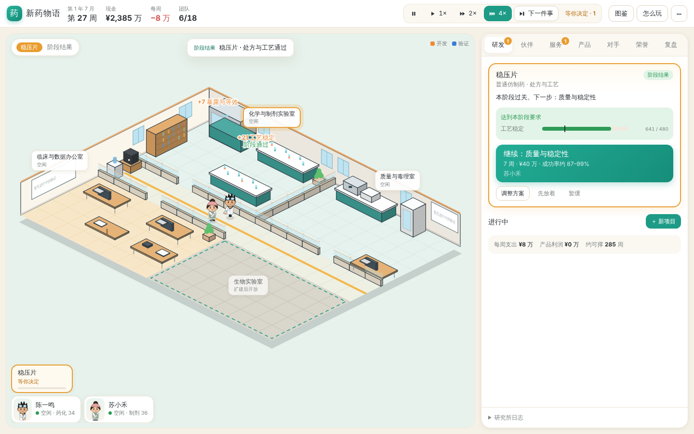
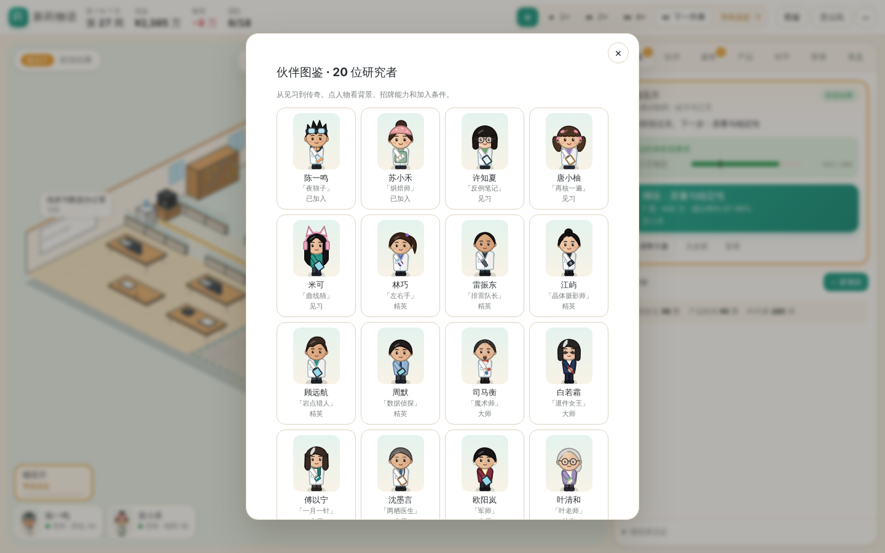

# 新药物语 · 一屏研究所 v0.10

从街角实验室起步的制药经营游戏。点选房间和伙伴，安排仿制、改良或创新研发；用服务与授权维持现金流，培养普通角色，挑战年度奖项和终局科学荣誉。

**v0.10 主要减轻操作负担。** 决定卡上的大按钮就是引擎核对过的推荐方案，点一下就开工；技术服务默认派能力最低的合格伙伴；时间按你选的速度走，遇到决定会停，决定完自动继续。画面统一为明快风格，20 位角色重画。



[当前玩法](design/game-design.md) · [内容与角色](design/content.md) · [技术接口](design/tech.md) · [本版试玩记录](design/v10-playtest.md) · [v0.9 记录](design/v09-playtest.md) · [v0.8 平衡记录](design/v08-playtest.md) · [历史场景原型](design/ui-claude/README.md) · [GitHub Releases](https://github.com/LucasYL/drugstory/releases)

## 开始游玩

需要 Python 3.12+ 与 uv：

```bash
git clone https://github.com/LucasYL/drugstory.git
cd drugstory
uv sync --dev
./scripts/run-career.sh
```

打开 **http://127.0.0.1:8885/scene**。文字界面在 **http://127.0.0.1:8885/**。

1. 点左上角提示或右侧「＋ 新项目」，选一张卡点「开始筛选」。新手推荐稳压片。
2. 点 ▶ 1× / 2× / 4× 让时间走。有决定会自动停，决定完自动继续；⏭「下一件事」直接跳到下一件需要你的事。
3. 右侧决定卡的大按钮写着周数、费用、成功率和负责人，点一下就执行。想换人或换方案，点「调整方案」。候选并排比较，标出「稳妥」和「潜力」。
4. 「服务」页每单一键接下，默认派能力最低的合格伙伴；两单以上可以「全部接下」。
5. 顶部一直显示现金、可用现金和每周净收支。现金只够撑 16 周以内时提示条变红；现金转负会自动暂停。
6. 橙色飘字是开发（让药变好），蓝色读数是验证（看清药有多好）。画面不影响成功率。

快捷键：空格 暂停/继续，1、2、3 切换速度，N 下一件事。每次成功操作都自动存盘；刷新后保持暂停。「⋯」菜单里可以导出存档、打开文字版、重新连接。

```bash
uv run drugstory-web --port 8885 --seed 42 --save-path saves/scene-autosave.json
uv run drugstory-web --difficulty competition --port 8897 --save-path saves/challenge-v10.json
uv run drugstory-web --load saves/my-v9-copy.json --save-path saves/resumed-v10.json --port 8898
uv run drugstory --scenario foundation --seed 42
```

**v0.10 沿用 v8 存档格式，v0.8、v0.9 的存档都能读。** 如要续玩，先手动复制存档，再用独立路径加载；不要让两个服务同时写同一文件。不会自动迁移、覆盖或推进旧版玩家存档。服务只监听本机。

## 跨设备试玩

v0.10.1 支持挂在 HTTPS 子路径上。试玩入口为 [researchbuddy.cc/game/](https://researchbuddy.cc/game/)，从电脑和手机使用同一游戏账号登录时，共用服务端存档。多个设备同时操作会触发版本冲突提示，重新读取进度后再决定。

自行部署时，先在仓库外准备权限为 600 的登录文件，写一行 `用户名:密码`。用反向代理终止 TLS，保留外部 Host 和原始路径，转发至本机端口：

```bash
uv run drugstory-web --port 8902 --public-url https://example.com/game/ \
  --auth-file /path/to/private/login.txt --save-path saves/hosted-autosave.json
```

线上模式的子路径首页显示场景，`/game/text` 是文字版。游戏资源和 API 都在同一前缀下，游戏服务绑定回环地址。通过独立保存路径保留跨设备进度。

## 本版变化

- **点得少：** 同一个仿制药从立项到上市，v0.9 要点 33 次，现在按「下一件事」14 次，开 4× 只要 10 次。立项、开工、继续、补正、上市都不用再开表单；表单仍在「调整方案」里。
- **技术服务默认人选：** 能力最低的合格空闲伙伴（回款不看能力，强的人留给研发），不重复推荐同一人，尽量不占待开工项目需要的人。
- **暂缓不再被遗忘：** 暂缓的项目一旦人和钱都够，卡片、提示条和底栏都显示「可以开工」；用不了时说明谁在忙、还要几周。
- **不会不知不觉破产：** 「下一件事」遇到新服务订单（有人空闲时）或现金转负会停；连续推进时现金转负自动暂停；招人时写明每周工资。
- **一屏布局与明快画风：** 桌面上整页不滚动；只保留明快画风；人物带眉眼、高光、腮红、18 种发型和完整配饰，场景、头像、图鉴共用一份画法。
- **更快：** 20 年存档的每周快照从约 39 毫秒降到约 9 毫秒。

研发、临床、经济和成长数值**沿用 v0.8，未调整**；只有「下一件事」在新模式下的停止条件是新的。默认玩家 48 局模拟里，年度奖偏多、人人传奇、第一款创新药偏晚，详见[试玩记录](design/v10-playtest.md)，留待下一版处理。



## 验证与复现

```bash
uv run pytest -q
uv run ruff check .
uv run ruff format --check .
node --test tests/test_scene_transport.cjs
uv run python scripts/generate-api-types.py
uv run python scripts/playtest-v10.py --seeds 12 --jobs 4
uv run python scripts/playtest-v08.py --seeds 6 --jobs 4
```

118 项 Python 测试、9 项 Node 测试（含 20 位角色 × 6 种姿势的绘制检查）；另检查全部 JS 语法、Schema 与类型同步，以及关键鼠标流程（立项到上市、服务、暂缓恢复、晋阶、图鉴、年度大会、桌面/笔记本/手机宽度、文字版）。

新增「只点推荐按钮」的默认玩家：2 种难度 × 2 种口味 × 12 个种子，每局 20 年，48 局零破产。v0.8 七种策略 28 局用当前代码重跑，结果与 v0.8 记录逐项一致。所有模拟和 UI 检查只用独立新局，输出在忽略的 `.artifacts/`；自动策略的结果不是人类胜率。

## 历史版本

每版保留不可移动 tag 和 Release。需要旧版时另建目录，按对应 README 指定独立端口和存档，不会自动关闭现有服务：

```bash
git worktree add --detach ../drugstory-v09 v0.9.0
cd ../drugstory-v09
uv sync --dev
uv run drugstory-web --port 8886 --save-path saves/scene-autosave.json
```

v0.9 默认也用 8885；和 v0.10 同时运行时，像上面这样给旧版换一个端口，各用各的存档。v0.8 使用 8884，v0.7 使用 8883，v0.6 使用 8881，v0.5 使用 8880。旧 MVP 引擎与测试可在 v0.3.0 查阅。
