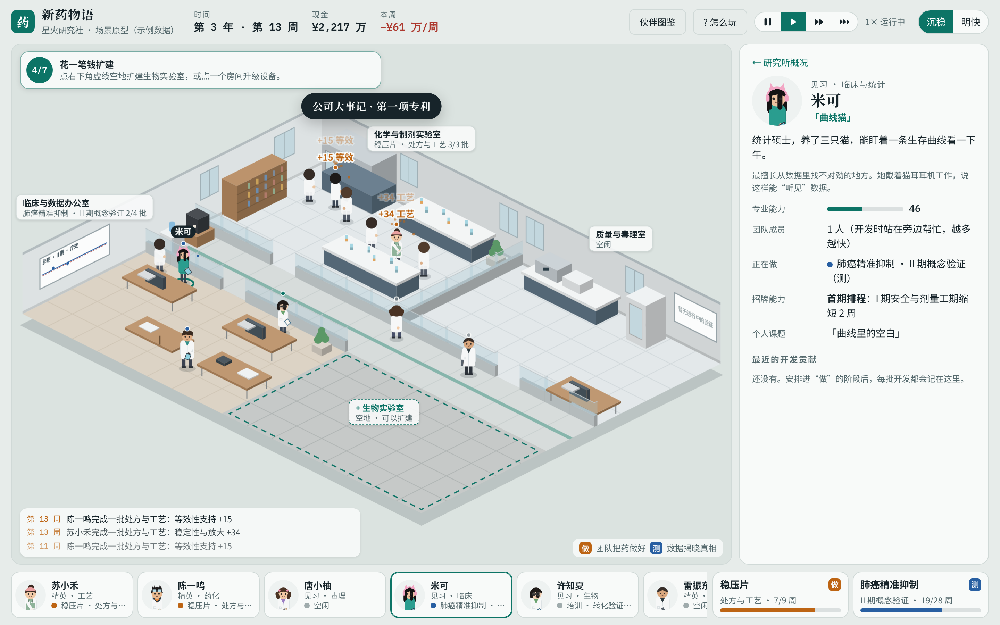
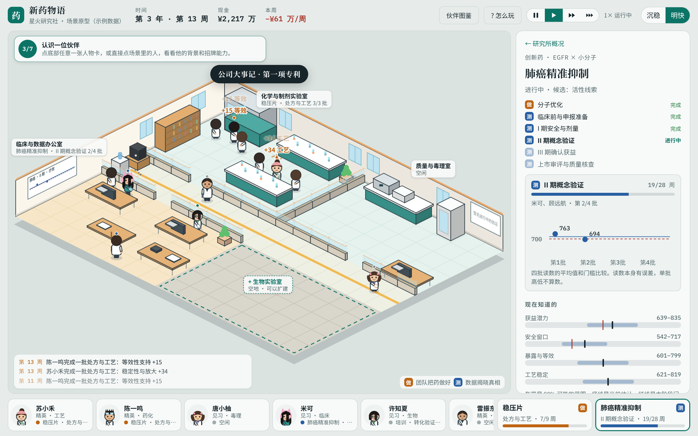
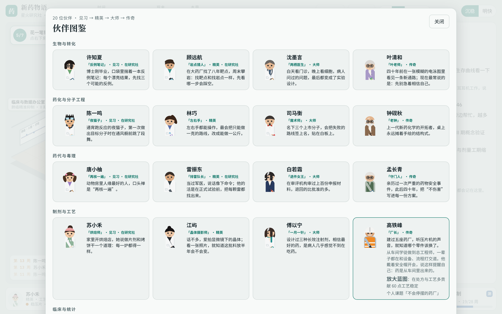
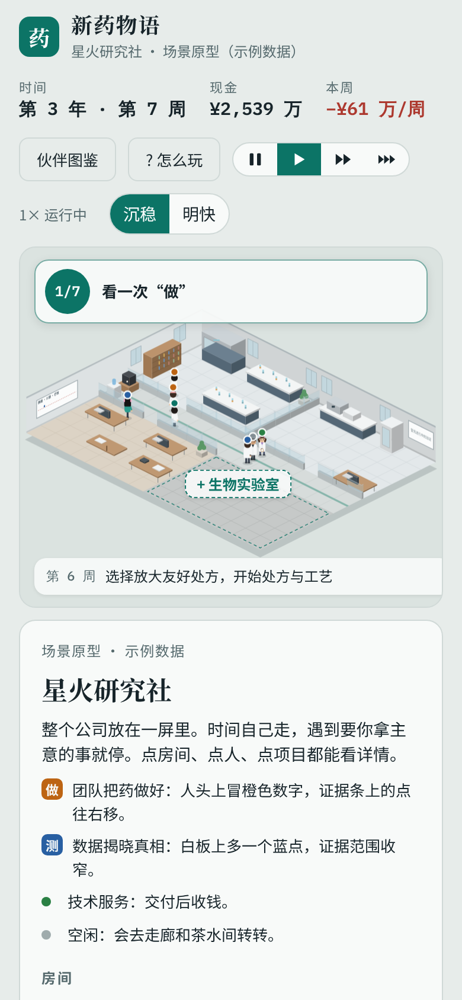

# 2.5D 方案 · Claude 版：一屏研究所

2026-11-05。这是和 [ui-v07 偏写实方案](../ui-v07/README.md) 对照用的第二个方向，**可以直接玩的交互原型**，使用示例数据。对 v0.7 其他部分的评估见 [review-v07-claude.md](../review-v07-claude.md)，评估里的规则问题已在 v0.8 处理（[v08-playtest.md](../v08-playtest.md)）。

**第二版（同日）：** 第一次打开有 4 步引导；场景左上角一直显示“下一步做什么”的目标条（7 个目标，做完打勾）；右上角「伙伴图鉴」能看全部 20 位角色；角色按 v0.8 的新名字、背景和外观数据重画，每人体型、发型、服装、配饰、手里的道具和空闲小动作都不一样；所有研究数字和 v0.8 一样乘以 10；专利授权、公司大事记、上市会弹横幅。



一句话：**整个研究所放在一屏里，画面全部用代码按数据画出来，人物只做三种状态，规则和画面用 v0.8 的事件格式对接。**

## 怎么打开

```bash
python -m http.server 8884 --bind 127.0.0.1 --directory design/ui-claude
```

打开 http://127.0.0.1:8884/ ，也可以直接双击 `index.html`。没有网络请求（字体来自 Google Fonts，打不开时用系统字体），不读写任何存档，不连 8883 的游戏服务。

建议这样看：

1. **跟着引导走 4 步。** 第一次打开会依次高亮场景、时间按钮、目标条和右侧面板。之后随时可以点右上角「? 怎么玩」重看。
2. **看左上角的目标条。** 它一直告诉你下一步做什么：选候选 → 看一次“做” → 做一次期中决定 → 认识一位伙伴 → 花钱扩建 → 让稳压片上市 → 翻一翻图鉴。点开能看全部目标。
3. **看“做”和“测”。** 苏小禾、陈一鸣在实验室干活时，头上冒橙色数字，比如“+34 工艺”；临床办公室的白板上多一个蓝点，是数据回来了。
4. **点东西。** 点房间、人物或底部卡片看详情。人物面板有外号、背景、招牌能力和个人课题；项目面板的证据条里，竖线右移是“做”，蓝色范围收窄是“测”。
5. **花钱。** 右下角空地可以扩建生物实验室；房间面板里可以升级设备，房间里会多一台仪器。
6. **翻图鉴、换画风。** 右上角「伙伴图鉴」里有 20 位伙伴；「沉稳 / 明快」两种画风是同一套代码。

快捷键：空格暂停或继续；1、2、3 切换 1×、2×、4×；Esc 把当前决定“稍后再说”。





## 核心思路

1. **一屏看到整个公司。** 开罗式经营最重要的体验，是一眼看到所有人在忙什么。镜头固定，不旋转、不缩放；房间是 8×5 格的模块，扩建就是加一块。
2. **画面全部由代码绘制。** 地板、墙、家具是几何体；人物由七八个形状加“发型、配饰、颜色”数据组成。没有图片素材，所以不存在“整图拆层”“20 个角色画风一致”“每个动作都要画”的问题。
3. **不画前墙。** 只画两面外墙，室内用矮墙加玻璃隔开。人永远看得见，不需要前景遮挡层。
4. **人物只有三种状态：走、干活、闲着。** 另外加一个庆祝时跳一下。走路是两帧腿摆动，干活是手臂动加一点粒子。不做坐下、拿东西、多方向动作。
5. **规则和画面完全分开。** 场景只读“谁在哪个房间做什么”和事件（`work_completed`、`evidence_received`……）。人物走路不影响任何结果，时间也不等动画。
6. **时间持续流动，遇到决定自动停。** 有 1×、2×、4× 三档速度。决定卡贴在场景底部，场景大部分仍然看得见。可以“稍后再说”，提醒气泡会留在对应房间上。
7. **“做”和“测”用颜色固定区分。** 橙色是“做”：开发批次、头上冒数字、证据条的竖线右移。蓝色是“测”：白板上的数据点、证据范围收窄。这是 v0.7 起规则里最重要的区别，画面直接教给玩家。
8. **团队人数看得见。** 负责人开工时，他的成员站在旁边一起干活。“团队数量”这个核心变量在画面上就是人多。
9. **场景负责“看见”，面板负责“决定”。** 要认真读的数字（证据、费用、概率）都放在右侧面板和决定卡里，用普通网页组件。
10. **一直告诉玩家下一步。** 新手引导只讲四件事；之后由目标条接手，时间停下时它会说“先在下方卡片里做决定”，有暂缓的事时会说“点橙色气泡”。
11. **角色就是数据。** 外观由体型、发型、服装、配饰、道具、小动作组合而成，和引擎共用一份数据（`cast.js` 由 `design/tools/cast_js.py` 从游戏数据生成）。重要的工位让人站在台子后面、脸朝镜头，干活时也认得出是谁。

## 和 GPT 两版方案的对比

| | v0.6 微缩模型 | v0.7 偏写实 | 本方案 |
|---|---|---|---|
| 画面来源 | AI 生成的整张概念图 | AI 生成的整张概念图 | 代码按数据绘制 |
| 能不能直接用进游戏 | 不能，要照着重画再拆层 | 不能，要重画、拆层，还要做成人比例动画 | 原型就是游戏画面本身 |
| 一屏能看到 | 约 4 间房（示意） | 2 间房 | 4 间房加走廊，还能放到 6–8 间 |
| 人物动画成本 | 中：Q 版，仍要逐人绘制 | 高：7 头身的走、坐、手部动作 | 低：代码动画，三种状态 |
| 20 个角色 | 逐个绘制 | 逐个绘制，再做动画 | 写 20 行外观数据 |
| 遮挡 | 要处理前墙 | 要做前景遮挡层 | 不画前墙，没有遮挡问题 |
| 扩建 | 每种房间都要新画 | 每种房间都要新画 | 加一块格子和几件家具数据 |
| 换风格 | 重新生成图片 | 重新生成图片 | 改一组参数（原型里能切换） |
| 现在能做的 | 点热点，示例流程 | 静态图 | 时间流动、事件驱动、做决定、扩建、升级 |

GPT 方案里我同意的部分：

- 规则由 Python 引擎决定，动画不影响结果；
- 先做小闭环，镜头固定，不做自由建造；
- 保留文字入口，用事件驱动场景。

分歧在两点：美术怎么做出来，以及一屏能看到多少。

“偏写实”的气质可以保留：真实的实验室家具、接近成人的比例、克制的配色。“沉稳”画风就是这种取向的低成本版本。

## 代价和局限

- **画面干净但朴素。** 达不到手绘或渲染图的质感。想要更精致，可以逐步把家具换成精灵图，占地格子不变，逻辑不用动。人物可以继续用代码画，或者换成“身体加配件”的分层素材。
- **人物小。** 桌面上约 40 像素高，靠颜色和配饰区分。手机上更小，所以手机主要靠底部人物栏点选。
- **示例驱动是缩小版规则。** 照 v0.8 实现了：开发三批、验证四批、期中继续或止损、门槛、成员和招牌能力的开发量公式、点数显示、专利授权与大事记事件。但只覆盖一款仿制药和一个 II 期创新药，II 期读数是写死的示例。
- **没做的：** 碰撞避让、坐下、音效、存档、个人课题和年度大会的场景。
- **代码规模。** 约 3,800 行，其中 CSS 约 1,000 行。没有依赖，也没有构建步骤。

## 怎么接 v0.8 的真实引擎

`sim.js` 只对外提供三个函数：`tick()` 推进一周，`act(name, args)` 执行一个决定，`view()` 给出画面和面板要的数据。接真实引擎时，写一个同样接口的 `ApiDriver` 换掉它，`scene.js` 和 `ui.js` 不用改：

- **启动**：读一次 `GET /api/content`，再读 `GET /api/state`。
- **时钟**：每周发一次 `POST /api/action`，内容是 `{name: "advance", args: {weeks: 1}, revision, request_id}`。只要有未暂缓的待决定项目，就停。
- **事件**：用返回的 `transition_events` 驱动 `scene.event()`。丢了事件就按快照恢复，tech.md 已经是这样设计的。
- **决定**：卡片按钮对应现有命令：`choose_candidate`、`continue_and_run`、`trial_decision`（keep / stop）、`rework`、`terminate`、`launch`、`license_project`、`upgrade_equipment`、`upgrade`。
- **人物位置**：从 `heroes`、`projects[].team`、`jobs` 推出“谁在哪个房间”，房间用下面这张表对照。

v0.7 缺的场景数据，v0.8 已经补上：

1. **房间表**：`/api/content` 的 `rooms`，每个阶段在规则数据里写明所在房间，事件里不再有 `room_lab`。
2. **人物类型**：schema v2 的 `Hero`，带 `look`（外观）、`room`（当前所在房间）、`activity`（make / test / service / study / idle）。
3. **外包标记**：阶段事件的 `data.executor` 为 `cro` 时，场景让“外包 CRO”的人出现在临床办公室。
4. **点数显示**：读数、门槛、开发量在接口里已经乘以 10；读数不再假装有 100 的上限。
5. **资金明细**：`cash_changed` 带 `income` / `expense` 分类，场景可以只对销售、里程碑这类收入做反应。
6. **新事件**：`product_launched`、`facility_upgraded`、`service_completed`、`deal_signed`、`patent_*`、`milestone_reached`、`award_won`、`legacy_reached`。

还没做的：时间持续流动后的存盘频率（建议在决定点和每月存档，连续推进合并成一条记录）。

## 分三步做成游戏

1. **接真实引擎，跑通一款仿制药。** 写 ApiDriver、房间表，做 4 个房间和起步的 2 个人，文字界面保留。验收：从立项到上市不用切回文字界面；刷新后人和进度都在。
2. **把所有决定搬进场景。** 包括创新药、授权、个人课题（共研教室）、年度大会（会议室领奖），晋阶时只加配件、不换人。
3. **扩建和设备。** 场地升级就是加房间模块，设备升级就是房间里多仪器。这也解决了后期钱没处花的问题。之后再考虑美术升级，比如用精灵图替换家具。



## 文件

- `index.html`、`style.css`：页面和界面样式
- `cast.js`：20 位角色的数据，由 `design/tools/cast_js.py` 从 `src/drugstory/career/data` 生成
- `scene.js`：等距场景，只负责画和点
- `sim.js`：示例驱动，缩小版 v0.8 规则
- `ui.js`：时间、面板、决定卡、底栏、新手引导、目标条、伙伴图鉴
- `preview-*.png`：截图
