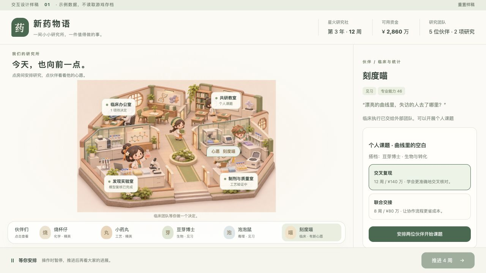

# 2.5D 研究所：视觉与交互设计 01

2026-11-04。已确定画风：**柔和的微缩模型风，像放在桌上的小研究所，人物与房间有立体感。** 本轮完成概念图、可点击交互样稿与实现边界；尚未制作完整 2.5D 游戏界面。



## 本轮可以体验什么

在仓库根目录运行：

```bash
python -m http.server 8882 --bind 127.0.0.1 --directory design/ui-v06
```

打开 http://127.0.0.1:8882/ 。也可以直接打开本目录 `index.html`。样稿没有网络请求，不读取、写入或迁移任何游戏存档；刷新或「重置样稿」恢复示例状态。

建议体验顺序：

1. 点临床办公室，比较原方案与补充患者随访，做一个中途决定。
2. 点场景中的刻度喵「心愿」，或底部人物栏；查看专业、身份和个人课题。
3. 选「交叉复现」或「联合交接」，安排与豆芽博士共同研究。
4. 推进 4 周，观察课题进度；累计 12 周或 8 周后出现成长纪念。
5. 点其他房间、人物，比较未来的内容组织方式。

这是**场景概念图上的点击区域与示例流程**，不是已经完成的场景引擎。真实 v0.6 玩法在 8881 的文字界面中运行。样稿里的研究报告、资金、人物能力是演示数据，只有这条课题和临床选择有局部交互，其他房间展示信息组织方案。

## 视觉方向

固定斜视角，低墙剖开四个房间，暖白、鼠尾草绿和浅木色为主。器械保留移液、分析、离心、数据工作站等现代研究辨识，避免看起来像中药铺。人物用夸张比例与易识别的帽子、眼镜、工具建立记忆，不追求真人写实。

概念图是**中期研究所**。开局只展示租来的小场地、两间工作区和少数伙伴；后续增加独立质量室、临床办公室、共研教室，再扩展到研究园区。不要一开局就把豪华场景全部送给玩家。

同一角色晋阶时保留脸型和基本轮廓，新增专业工具、徽章、动作与手记。传奇可以有特殊工作表现，但普通伙伴的外貌与协作能力不会被新角色抹掉。角色服装与动作应有专业区分；当前生成图尚未达到 20 人一致的角色设定标准。

## 主屏如何操作

| 入口 | 玩家想做的事 | 反馈 |
|---|---|---|
| 发现实验室 | 比较候选、安排机制与优化研究 | 候选证据卡、工作台状态、剩余时间 |
| 制剂与质量室 | 工艺、稳定性、杂质、供货验证 | 正在处理的产品特性、批次与设备动作 |
| 临床办公室 | 试验方案、临床中途选择、外包与授权 | 时间和成本差异、覆盖范围、证据说明 |
| 共研教室 | 个人课题、导师带教、联合研究 | 合作的人物、课题进度、完成纪念 |
| 场景人物或底栏头像 | 看状态、培养、调配工作 | 同一个人物面板；避免必须在场景里追着人物点 |
| 决策提醒 | 直接跳到需要处理的项目 | 一次只处理一个关键问题，可暂缓 |
| 年度大会 | 报名、对手差距、获奖与终局进度 | 简短仪式与可回看的奖杯墙 |

主屏长期只保留资金、时间、团队和待处理数量。详细科学证据仍用清晰文字与表格呈现；进入房间后才显示。场景承担导航、状态和情感连接，右侧面板承担需要认真读的选择。

时间由玩家控制。打开面板时不偷偷消耗资源；点击推进后，人物和设备播放短动画，到关键决策或任务完成停下。动画可加速或跳过；安排工作不要求等待人物走到目的地。视觉走位不参与临床结果、费用或研究计时。

房间和人物都必须有明确 hover / focus / selected 状态；图像不能代替按钮的文字与键盘入口。窄窗口改为上下布局；桌面版本先保证场景、队伍与时间按钮能同屏看见。当前已检查 1280×720；尚未完成移动设备和高分屏的完整测试。

## 真正变成小游戏的实现顺序

### 第一段：只做一条完整闭环

两个模块化房间、烧杯仔和小药丸两位角色、一条仿制项目。能点人分配工作，人物能走到工作位并播放研究动作；筛选、候选选择、工艺、质量、等效性、审评与上市都调用现有正式规则。保存后重新打开，任务、人物岗位与进度恢复。

验收看三个问题：人物与房间是否容易点；是否知道下一步该做什么；一个项目从开工到上市是否比文字界面更顺手。先通过这条闭环，再扩充所有房间与人物，不一开始制作整座科学城。

### 第二段：人物养成与有意义的打断

接入个人课题、共同研究、临床中途选择、阶段结果与待办队列。加入课题完成动作、晋阶外观差异、年度大会和奖杯墙。日常重复安排仍保留批量入口；演出不应为每笔小收入弹窗。

### 第三段：扩建与长期成就

地图随场地扩建，设备按实际工作需求解锁；随后接市场、授权、对手情报和终局仪式。布局自由度先限于功能区域和装饰，验证玩家确实喜欢布置后再考虑完整摆放系统。房间位置暂不增加隐藏效率公式。

## 画面与规则如何衔接

建议采用固定等距投影的 2D 场景层，使用带光影的预渲染房间、设备和角色动画素材，做出 2.5D 观感。面板继续使用普通网页组件。先验证素材的视角、深度遮挡和缩放质量，再确定具体渲染库，不为本次样稿引入新引擎。

素材按地板、后墙、家具、人物、前墙遮挡层拆分；人物沿有限的工作点和通道移动。前墙可淡化，不能遮住任务入口。深度顺序按脚下位置与遮挡层决定；游戏规则不依赖动画完成事件。

- 原有 Python 规则引擎继续决定花钱、计时、随机结果和存档。
- 场景读取同一份公开快照，通过正式 action 提交操作；不能获得隐藏候选性质。
- 有实际功能的房间与现有场地、任务、槽位对应；不凭装饰图片发额外科研分数。
- 先逐条接入并保留文字入口作对照，确保同一存档、同一动作产生同一结果。
- 第一批素材需求：2 个房间模块、地板与墙、4–6 件设备、2 位人物各自站立/行走/研究/庆祝动画、选择圈与任务图标。画面验证后再量产 20 位人物。

## 资产与本轮验证

- `research-institute-concept.png`：内置 image_gen 生成并定向修订的概念图，不是完整游戏截图。
- `interaction-preview.png`：浏览器实际运行交互样稿的截图。
- `prompts.md`：两次生成/修订的完整提示词，使用内置工具，未使用 API CLI。
- `index.html`、`concept.css`、`concept.js`：独立可运行样稿，不依赖外部字体或网络资源。

已用鼠标验证：临床随访扣除示例预算 → 点击刻度喵 → 开始共研 → 三次推进 → 成长纪念 → 重置；修正了小窗口中场景与人物栏被挤出首屏的问题。尚未交付人物动画、真实游戏状态绑定、自由摆放或完整美术素材。
