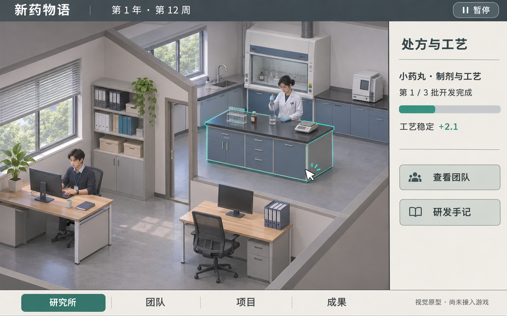

# 偏写实办公室与实验室 · 视觉原型

这是 2026-11-04 按用户新偏好绘制的**静态视觉原型**，不是已实现的交互游戏截图。采用内置 imagegen；完整提示词在 [prompt.txt](prompt.txt)。图中时间、人物安排与进度均为设计示例，未绑定玩家存档。原始输出已复制进本目录，旧 ui-v06 保留为历史方向。

## 为什么先做这一步

难点不只是把背景换成实验室：

1. **能复用的美术资产。** 一张整图不能直接变成会走的人。需要拆背景、前景遮挡、设备与透明人物，并保持镜头角度、光线、人物比例一致；立绘不等于可用动作素材。
2. **空间与点击。** 走到工作台后，人物一部分在桌后、一部分在桌前；房门与墙会挡人。点击桌子、角色和右侧面板还要避免抢焦点，小屏也必须能读。
3. **行为与规则对应。** 不能让角色永远摆动而结果没变化。需要将工作批次、观察读数、等待决策、空闲与晋阶映射成不同状态，动画不改变结算。
4. **时间与恢复。** 自动推进要遇到决策就停，切换页面、断线、刷新、重复请求后也不能多扣钱或漏结果。现有原子存档应先保留。
5. **内容成本。** 二十人每人多方向行走、实验、坐下、讨论、庆祝会迅速放大制作量。第一步用少量通用动作和服装/配色区别角色，再逐渐增加个性动作。

## 克制的第一份交互原型

固定斜俯视镜头，一间办公室、一间实验室，两个人，一个项目；不做自由建造、镜头旋转和复杂寻路。背景与前景分层，人物只在少数固定工作位移动，先有空闲、工作、等待三个状态。

- 点人物：选中高亮，右侧展示职业、能力、当前任务和团队安排。
- 点工作台：右侧展示真实项目与开发批次，调用已有阶段安排。
- 点项目提示：查看已有证据；到期中决策时暂停，继续或止损。
- 点底部菜单：切回文字列表，保留批量订单、候选比较、荣誉和日志效率。

验收顺序：先可点击静态热点并接入真实存档 → 两人三状态与前景遮挡 → 串行自动时间和暂停 → 再扩房间与动作。一个范围完整、能恢复进度的片段，比先做二十个精美人物更能验证方向。

## 图的限制与需要再决定的地方

图中偏写实材质和成人比例是本轮方向。最终制作可减少纹理、窗外细节和小器械，保持相同空间布局；它不构成承诺最终能逐像素还原。右侧数字是游戏开发贡献，不是现实药物指标。当前图不具备实际点击、动画或模型文件。
